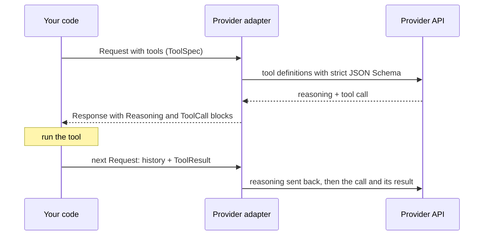
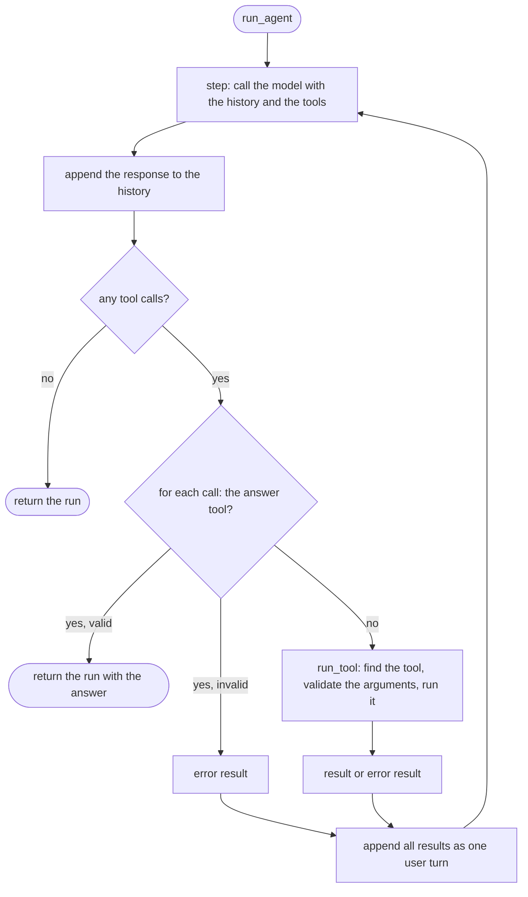
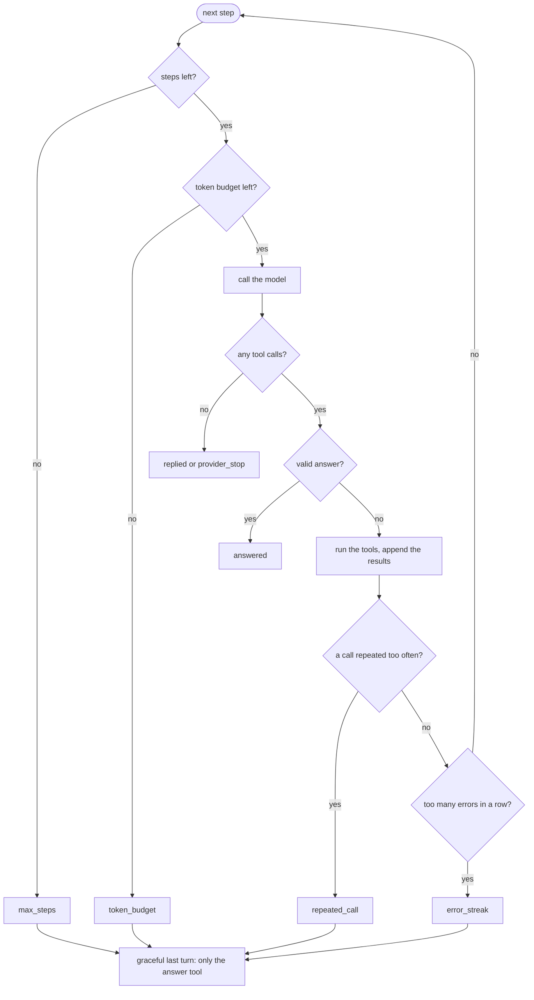

# Phase 2: Tool use and the agent loop

An agent is a model that can act: it requests actions, your code carries them out, and the
results shape what it does next. This phase builds that loop from scratch, with no framework,
on top of the Phase 1 client.

## 2.1 Function calling

### How it works

The model never runs anything. It can only ask:

1. **You describe tools** in the request: a name, a description, and a JSON Schema for the
   arguments.
2. **The model asks for a call** instead of answering: a tool name, arguments that follow the
   schema, and a call ID.
3. **Your code runs the tool** and sends the result back, tagged with that call ID.
4. **The model continues**: it asks for more calls or gives its answer.

Steps 2–4 repeat; that repetition is the agent loop (2.2).

### On the wire

| | Anthropic Messages | OpenAI Responses |
| --- | --- | --- |
| Tool definition | `name`, `description`, `input_schema` | `type: "function"`, `name`, `description`, `parameters`, `strict` |
| The model's call | `tool_use` content block: `id`, `name`, `input` (an object) | `function_call` output item: `call_id`, `name`, `arguments` (a JSON string) |
| "Waiting on tools" | stop reason `tool_use` | `function_call` items in the output |
| Your result | `tool_result` block in the next user message: `tool_use_id`, `content`, `is_error` | `function_call_output` input item: `call_id`, `output` |
| Forcing a choice | `tool_choice`: `auto`, `any`, `tool`, `none` | `tool_choice`: `auto`, `required`, a named function, `none` |

The concepts match; the shapes don't. As with messages in Phase 1, the client defines one
shape and each adapter translates.

### What to get right

- **One response can request several calls.** Run them all and return every result in the
  next request, each with its own call ID. Parallel calls can be turned off
  (`disable_parallel_tool_use`, `parallel_tool_calls: false`) when order matters.
- **Arguments are model output.** Strict mode constrains them to the schema, as structured
  outputs do (1.5), but not their values: an ID can be well-formed and still not exist.
  Validate before acting.
- **Errors are results.** A failing tool returns an error message to the model (with
  `is_error` on Anthropic) instead of crashing the program. Most models recover: they fix the
  argument or try another tool.
- **Reasoning travels with tool calls.** Reasoning models think before and between calls
  (1.6). Anthropic requires the assistant turn's thinking blocks to come back complete and
  unmodified alongside the tool results. OpenAI, when used without server-side storage
  (`store: false`), returns reasoning as encrypted items that must be requested
  (`include: ["reasoning.encrypted_content"]`) and sent back in their original order.
- **Tool definitions are input tokens.** They are sent with every call and sit at the start of
  the prompt, so keep them stable: they are part of the cacheable prefix (1.7).
- **Forcing a tool can conflict with thinking.** Anthropic models with extended thinking
  accept only `auto` or `none`.

### In the code

This section follows one tool call through the client: the tool is described, sent, called
by the model, answered, and the model's reasoning is carried along to the next request.



**1. Describe the tool.** A `ToolSpec` names the tool, says what it does, and gives its
arguments as a Pydantic model, as the answer's shape is with `output_type` (1.5): one class
gives the schema sent to the model and later validates what comes back
(`core/src/core/llm/types.py`):

```python
class ToolSpec(BaseModel):
    name: str = Field(pattern=r"^[a-zA-Z0-9_-]{1,64}$")
    description: str
    input_type: type[BaseModel]
```

**2. Send it.** `Request`, the client's description of one call, carries the specs in its
`tools` field:

```python
tools: list[ToolSpec] = Field(default_factory=list)
```

Each provider adapter, the module that translates between these types and one SDK, turns a
spec into its provider's definition, with the schema in strict mode. `to_strict_json_schema`
is the OpenAI SDK's converter from a Pydantic model (`core/src/core/llm/openai_provider.py`;
the Anthropic one differs only in field names):

```python
def to_openai_tool(spec: ToolSpec) -> dict[str, Any]:
    return {
        "type": "function",
        "name": spec.name,
        "description": spec.description,
        "parameters": to_strict_json_schema(spec.input_type),
        "strict": True,
    }
```

**3. Read the call.** The adapter turns the provider's call into a `ToolCall`, one kind of
content block, the pieces a message is made of. Arguments stay a JSON string because OpenAI
sends one; the Anthropic adapter serializes its object to match:

```python
class ToolCall(BaseModel):
    id: str
    name: str
    arguments: str  # JSON, exactly as the model wrote it
```

`Response`, the normalized reply, lists the calls the model made:

```python
@property
def tool_calls(self) -> list[ToolCall]:
    return [block for block in self.content if isinstance(block, ToolCall)]
```

Its stop reason is `tool_use` on both providers. OpenAI reports such a response as plain
`completed`, so its adapter derives the reason itself; `called` is true when the output
contains a function call, and `raw` is the provider's own status, kept for debugging:

```python
return ("tool_use" if called else "end_turn"), raw
```

**4. Answer it.** Before running the tool, its arguments are validated like structured
output, where `spec` is the called tool's `ToolSpec` and `call` the `ToolCall`:
`spec.input_type.model_validate_json(call.arguments)`. The outcome goes back as a
`ToolResult`, linked to the call by its ID:

```python
class ToolResult(BaseModel):
    call_id: str  # the ToolCall's id
    content: str
    is_error: bool = False
```

Calls come from the assistant and results from the user. A message refuses blocks its role
can't carry, so a result put in the wrong turn fails when the message is built, not at the
provider:

```python
ROLE_BLOCKS: dict[Role, set[str]] = {
    "user": {"text", "tool_result"},
    "assistant": {"text", "tool_call", "reasoning"},
}
```

**5. Carry the reasoning.** The reasoning that produced the call is kept as a third kind of
block, holding the provider's data untouched, and goes back in the next request ahead of the
call. Each adapter sends back only its own provider's reasoning:

```python
class Reasoning(BaseModel):
    provider: str
    data: dict[str, Any]
```

OpenAI keeps nothing between calls when `store` is false, so its encrypted reasoning has to
be requested whenever tools are sent:

```python
params["include"] = ["reasoning.encrypted_content"]
```

### Choices and alternatives

| We chose | Alternatives | When they win |
| --- | --- | --- |
| Our own tool types, with one adapter per provider | The provider SDK's helpers: Anthropic's SDK has a `@beta_tool` decorator and a tool runner that executes the loop; the OpenAI Agents SDK does the same for OpenAI models. Or a framework's tool layer (LangChain, Pydantic AI) or a gateway such as LiteLLM that maps every provider to one format. | SDK helpers when one provider is enough: less code, and new provider features arrive first. A framework or gateway when you want its integrations and can accept its abstractions. Your own layer when you need several providers and full control over what is sent and logged, as here. |
| Arguments defined as a Pydantic class | A JSON Schema written by hand, or a schema derived from a function's signature and docstring (what most `@tool` decorators do) | Derived schemas for quick prototypes. A class when the same shape is validated in several places, or reused across tools. |
| Strict mode on every tool | Non-strict schemas, validated only after the call | Non-strict when a schema needs keywords strict mode doesn't support. Validation runs either way: strict mode guarantees shape, not values. |
| Stateless calls: the client resends the whole history and carries reasoning itself | Server-side state: OpenAI's Responses API can store a response and continue from it with `previous_response_id`, so only the new turn is sent | Server-side state for simpler code and smaller requests, when storing conversations with the provider is acceptable. Stateless when data retention rules forbid storage, or to keep conversations portable across providers. |
| Parallel calls allowed, `tool_choice` left on `auto` | Parallel calls turned off; a forced tool choice | Sequential calls when one call's result decides the next and the model tends to guess ahead. Forcing a tool for a fixed first step, where the model allows it. |

## 2.2 The agent loop

### The loop

An agent is a model, a set of tools, instructions, and a loop that connects them:

```
messages = [task]
repeat:
    response = model(instructions, messages, tools)
    append the whole response to messages     # text, reasoning, and tool calls
    if the response has no tool calls: done   # its text is the answer
    run every tool call
    append all the results to messages, as one user turn
```

The model decides what happens next at every step; the code only executes. That is the
difference from a **workflow**, where code fixes the sequence of steps and the model fills in
each one. Workflows are cheaper and more predictable; agents handle tasks whose steps can't be
known in advance. Use the simplest one that works
([Anthropic, 2024](https://www.anthropic.com/engineering/building-effective-agents)).

### Reasoning and acting

The pattern of alternating thought and action was named **ReAct**
([Yao et al., 2022](https://arxiv.org/abs/2210.03629)): the model reasons about what it knows,
acts to learn more, observes the result, and repeats. Early implementations prompted for it
with "Thought: / Action: / Observation:" text formats and parsed the output. Current models
do it natively: reasoning happens in thinking tokens, actions are tool calls, and
observations are tool results. Text formats are no longer needed.

### Running the tools

For each tool call, the loop:

1. **Finds the tool by name.** An unknown name is an error result, not a crash.
2. **Validates the arguments** against the tool's schema. Invalid arguments are an error
   result that says what was wrong, so the model can retry.
3. **Runs it** and turns the output into text. An exception inside the tool is an error
   result too.

Every call gets exactly one result, with its call ID, and all results from one response go
back together. Calls in one response are independent by construction (the model issued them
without seeing each other's results), so they can run concurrently.

### What the loop costs

Every step resends the whole history: instructions, tool definitions, the task, and every
earlier call and result. Input grows with each step, and total input grows roughly with the
square of the number of steps (1.1). Keeping the history append-only makes each request
extend the previous one, so prompt caching can serve most of it (1.7). Large tool outputs are
the usual culprit when a loop gets expensive; 2.4 covers keeping them small.

### Getting a usable answer

The loop ends when the model answers without calling a tool. For a program to use that
answer, it needs a defined shape. Two ways:

- **Structured output on the answer**, as in 1.5. "Done" stays implicit: the model ends by
  not calling a tool, and any plain-text reply ends the loop too.
- **An answer tool**: a tool whose arguments are the answer's schema, such as
  `submit_decision`. Calling it ends the loop. "Done" becomes an explicit action whose
  arguments are validated like any other call, so a malformed answer goes back to the model
  as an error result instead of ending the run.

### In the code

The loop is `run_agent` in `core/src/core/agent.py`. Each pass through it makes one model call
and runs the tools that call asked for:



**The pieces.** A `Tool` pairs the `ToolSpec` the model sees with the Python function that
carries it out. `A` is the tool's argument class, so the function receives arguments that
have already been validated:

```python
@dataclass(frozen=True)
class Tool[A: BaseModel]:
    spec: ToolSpec
    run: Callable[[A], str]
```

A run's state is an `AgentRun`: the history in `run.messages`, and one `Completion` per model
call in `run.completions`. A `Completion` is what the Phase 1 client returns: the response
plus the record of the call.

**One step.** `step` sends the history so far with the tools on offer and appends the whole
response, so reasoning and calls go back to the model next time. `client.complete` is the
Phase 1 client's call, so every step is retried, priced, and recorded like any other call,
labeled with the caller's `labels` and its step number:

```python
def step(offered: list[ToolSpec]) -> list[ToolCall]:
    step_request = request.model_copy(update={"messages": list(run.messages), "tools": offered})
    completion = client.complete(
        provider, step_request, labels={**(labels or {}), "step": str(len(run.completions) + 1)}
    )
    run.completions.append(completion)
    response = completion.response
    if response.content:
        run.messages.append(Message(role="assistant", content=response.content))
    return response.tool_calls
```

The history is only ever appended to, so each request extends the one before, which is what
prompt caching needs. `list(run.messages)` gives each request its own copy, so later steps
can't change a request that was already sent.

**The loop.** No tool calls means the model has replied, and the run ends. Otherwise every
call gets exactly one result, and all of them go back as one user turn. `specs` are the
tools' specs plus the answer tool's, `by_name` maps each tool's name to the tool, and `stop`
records why the run ended and returns it. The lines marked for 2.3 are the stop conditions:

```python
while True:
    ...  # step and token limits, 2.3
    calls = step(specs)
    if not calls:
        return stop(...)  # "replied", or "provider_stop" for a cut-off reply, 2.3
    results = []
    for call in calls:
        if answer is not None and call.name == answer.name:
            if (error := take_answer(call)) is None:
                return stop("answered")
            results.append(error)
            continue
        ...  # count the call for repeat detection, 2.3
        results.append(run_tool(call, by_name))
    run.messages.append(Message(role="user", content=results))
    ...  # repeat and error-streak checks, 2.3
```

**Running a tool.** `run_tool` handles one call in three steps, and each either moves on or
returns an error result, a `ToolResult` with `is_error` set. `error_result` builds one, and
every message starts with `Error:` because OpenAI has no error flag (2.1):

```python
def run_tool(call: ToolCall, tools: Mapping[str, Tool]) -> ToolResult:
    tool = tools.get(call.name)
    if tool is None:
        available = ", ".join(sorted(tools))
        return error_result(call, f"Error: unknown tool {call.name!r}. Available: {available}.")
    try:
        arguments = tool.spec.input_type.model_validate_json(call.arguments)
    except ValidationError as exc:
        return error_result(call, f"Error: invalid arguments for {call.name}.\n{exc}")
    try:
        return ToolResult(call_id=call.id, content=tool.run(arguments))
    except Exception as exc:  # any failure inside a tool is reported, never raised
        return error_result(call, f"Error: {call.name} failed: {type(exc).__name__}: {exc}")
```

**The answer tool.** `answer` is a `ToolSpec` offered alongside the others. A call to it is
validated instead of run: `take_answer` stores valid arguments as the run's answer and
returns `None`, or returns an error result for the model to read:

```python
def take_answer(call: ToolCall) -> ToolResult | None:
    try:
        run.answer = answer.input_type.model_validate_json(call.arguments)
    except ValidationError as exc:
        return error_result(call, f"Error: invalid answer.\n{exc}")
    return None
```

### Choices and alternatives

| We chose | Alternatives | When they win |
| --- | --- | --- |
| An agent loop for a task with a fixed policy | A **workflow**: extract the fields with structured output (Phase 1), then apply the policy in code. Or a **hybrid**: the workflow handles clean cases and hands the rest to an agent. | The workflow whenever the steps are known in advance: it is cheaper, faster, deterministic, and easy to audit. The hybrid for most real document processing. A pure agent only when the steps can't be known in advance. This phase's lab measures the workflow against the agent on the same cases. |
| A hand-written loop | The SDK tool runners above; agent frameworks such as the OpenAI Agents SDK; graph frameworks such as LangGraph (Phase 4) | A framework when you need what it adds (handoffs between agents, tracing, persistence, human approval steps) and can accept its abstractions. Your own loop when it is small and you need control over every step, or to learn what the frameworks do. |
| An answer tool | Structured output on the final turn; free text parsed afterward | Structured output when there's no risk of the model ending early with prose. Free text only when a person reads the answer. |
| Tools run one at a time | Concurrent tool calls, with threads or `asyncio` | Concurrency when tools are slow network calls and the model issues several at once. |
| A synchronous loop, history kept in memory | An `async` loop; history persisted after every step, so a crashed run can resume (durable execution, Phase 9) | `async` in a service running many agents at once. Persistence whenever a run is long, expensive, or waits on people. |
| The full history resent every step | Compaction: summarizing or dropping old turns (Phase 3); provider-side context management | Compaction once histories approach the context window, or when old tool results are large and no longer needed. |

## 2.3 Stopping

### Why loops fail to end

A loop ends on its own when the model answers. When it doesn't, the cause is usually one of:

- **Repetition.** The same call with the same arguments, again and again, often because the
  result didn't contain what the model hoped for.
- **Error spirals.** Each fix to a failing call fails in a new way.
- **Wandering.** Calls that each look reasonable but never converge on an answer.
- **Running out of room.** The history grows until the output budget or the context window
  cuts the model off (1.2).

None of these raise an exception: they look like a working agent that costs more every step.
So the loop needs stop conditions of its own.

### Stop conditions

| Condition | Checked | Means |
| --- | --- | --- |
| Answered | after each response | Success: the answer tool was called with valid arguments. |
| Replied | after each response | The model ended without calling a tool. Success when no answer tool is offered; with one, the answer is missing. |
| Provider stop | after each response | The response was cut off or refused (`max_tokens`, `refusal`) and requested nothing. |
| Step limit | before each call | The run used its allowed number of model calls. |
| Token budget | before each call | The run's total tokens, input and output across all steps, passed its budget. |
| Repeated call | after running tools | The same tool was called with the same arguments too many times. |
| Error streak | after running tools | Too many tool results in a row were errors. |

The step limit and token budget are hard caps: they bound the worst case no matter what the
model does. Repeated calls and error streaks catch a stuck run early, before it reaches a cap.

### Ending gracefully

When a cap is hit, the loop can stop at once or give the model one last turn to answer with
what it has: the history plus a message that the budget is spent, with only the answer tool
offered. A graceful finish turns many would-be failures into usable, if less certain,
answers. Whatever it returns, the run still records that a limit was hit.

### Record why it stopped

A run's result carries its stop reason. A run that hit its step limit and then answered is not
the same outcome as one that answered on step three, even if both answers are right. Evals
should count stop reasons: a rising share of capped runs is often the first sign of a broken
tool or a regression in the prompt.

### Choosing the limits

Set limits from data, not guesses. Run the agent on representative tasks, look at how many
steps and tokens the successful runs used, and set each cap comfortably above the highest of
them. A cap that cuts off successful runs costs accuracy; one far above any successful run
only lets failures cost more.

### In the code

The stop conditions sit at three points in the loop from 2.2: before each model call, after
each response, and after each round of tool results. A cap ends the run through `stop`,
which first gives the model its graceful last turn:



**What a run records.** Each row of the stop-conditions table is one value of
`AgentStopReason`, and every run ends with one in `AgentRun.stop_reason`
(`core/src/core/agent.py`):

```python
AgentStopReason = Literal[
    "answered",  # the answer tool was called with valid arguments
    "replied",  # the model ended without calling a tool
    "provider_stop",  # the response was cut off or refused and requested nothing
    "max_steps",
    "token_budget",
    "repeated_call",
    "error_streak",
]
```

The caps are settings, so each agent can set them from its own data:

```python
@dataclass(frozen=True)
class Limits:
    max_steps: int = 20  # model calls, not counting the graceful last turn
    max_tokens: int = 200_000  # input plus output across all steps
    max_repeats: int = 3  # runs of one identical call
    max_error_streak: int = 3  # error results in a row
    graceful: bool = True
```

**Before the call.** The hard caps come first, so the loop never makes a call it can't
afford. `run.completions` holds one entry per model call so far, and `run.tokens` sums their
usage:

```python
if len(run.completions) >= limits.max_steps:
    return stop("max_steps")
if run.tokens >= limits.max_tokens:
    return stop("token_budget")
```

**After the response.** A response with no tool calls ends the run. `PROVIDER_STOPS` holds
the normalized stop reasons for a cut-off or refused reply (1.2): `max_tokens` and
`refusal`:

```python
calls = step(specs)
if not calls:
    last = run.completions[-1].response
    return stop("provider_stop" if last.stop_reason in PROVIDER_STOPS else "replied")
```

A valid call to the answer tool ends it as `"answered"`, as shown in 2.2.

**After the tools.** The stuck-run checks depend on the results, so they come last.
`calls_seen` counts every call the loop has run, keyed by `call_key`, and the error streak
counts error results in a row, resetting on any success:

```python
for result in results:
    error_streak = error_streak + 1 if result.is_error else 0
if max(calls_seen.values(), default=0) >= limits.max_repeats:
    return stop("repeated_call")
if error_streak >= limits.max_error_streak:
    return stop("error_streak")
```

Two calls count as the same when they name the same tool with the same arguments, whatever
the key order or spacing of the JSON:

```python
def call_key(call: ToolCall) -> tuple[str, str]:
    try:
        arguments = json.dumps(json.loads(call.arguments), sort_keys=True)
    except json.JSONDecodeError:
        arguments = call.arguments
    return call.name, arguments
```

**How a run ends.** `stop` records the reason first. For a cap, with an answer tool and
`graceful` on, it then adds a message saying why the run is ending and makes one last call
that offers only the answer tool. `CAPS` is the set of the four cap reasons, and `step` and
`take_answer` are the functions from 2.2. The stop reason stays the cap's even when that
turn produces an answer:

```python
def stop(reason: AgentStopReason) -> AgentRun:
    run.stop_reason = reason
    if reason in CAPS and limits.graceful and answer is not None:
        note = f"Stop: {reason}. Call {answer.name} now with your best answer."
        run.messages.append(Message.user(note))
        for call in step([answer]):
            if call.name == answer.name and take_answer(call) is None:
                break
    return run
```

The note follows the latest tool results, so the history has two user turns in a row.
Anthropic combines consecutive turns of the same role into one, and OpenAI's input is a flat
list of items, so both accept it.

### Choices and alternatives

| We chose | Alternatives | When they win |
| --- | --- | --- |
| A stop reason on the result | An exception when a limit is hit: the OpenAI Agents SDK raises `MaxTurnsExceeded`, and LangGraph raises `GraphRecursionError` | Exceptions when a capped run should halt the program. A recorded reason when capped runs are an expected outcome to count and handle, as in evals and batch jobs. |
| Caps on steps and tokens | A cap in dollars; a wall-clock timeout for the run and for each tool | A dollar cap when models with different prices share one budget. Timeouts in any service with a latency target, and for any tool that calls the network. |
| Exact-repeat detection | Detecting near-repeats (the same tool with similar arguments); a progress check, such as a cheap model asked whether the run is still moving forward | Near-repeat and progress checks for long, open-ended tasks, where loops rarely repeat exactly. Exact matching for short tasks with structured arguments, as here. |
| A graceful last turn | A hard stop; handing the run to a person, with the transcript, through a review queue | A review queue in most real approval systems: a capped run is a case the agent couldn't settle, and a person should see it. A hard stop when a partial answer is worse than none. |
| Limits set in code, per agent | Limits configured per deployment or per tenant, and changed without a release | Configuration once several agents or customers share the same loop and need different budgets. |

## 2.4 Tool design

A tool is an interface for a model, not for a programmer. A programmer reads the docs once and
handles edge cases in code; a model reads the definition on every call and decides from that
alone. The design rules follow from that difference
([Anthropic, 2025](https://www.anthropic.com/engineering/writing-tools-for-agents)).

### Choose tools for the task

Give the agent the few tools a person doing the job would want, not one tool per API endpoint.
`find_vendor(name)` beats `list_vendors()`: the agent has a name from the invoice, and a full
list would cost tokens on every later step and leave the search to the model. Fewer, more
capable tools also mean fewer wrong choices between overlapping ones.

### Names and descriptions

- **Names** say what the tool does with a clear verb, and related tools share a prefix or
  pattern so they read as a group: `find_vendor`, `get_purchase_order`, `find_invoices`.
- **Descriptions** are written like a note to a new colleague: what the tool does, when to use
  it rather than another, what the inputs look like, and what comes back. Each argument gets
  its own description in the schema, with its format.

Both are part of the prompt. A vague description causes wrong calls as reliably as a vague
system prompt causes wrong answers (1.4).

### Inputs that are hard to get wrong

- **Unambiguous argument names.** `vendor_id`, not `id`; `po_number`, not `number`.
- **Closed sets as enums**, so an invalid status can't be expressed (1.5).
- **Forgiving formats.** Accept `PO-1042`, `po-1042`, and `1042` if they all mean the same
  thing: normalizing in code is cheaper than an error and a retry.

### Outputs that are worth their tokens

A tool result goes into the history and is resent on every later step (2.2), so each token in
it is paid for many times.

- **Return what the task needs**: names alongside IDs, so the model doesn't need a second call
  to learn what an ID refers to; no internal fields the model can't use.
- **Bound the size.** Cap list results, and say when results were cut off and how to narrow
  the search.
- **Use a format the model reads easily.** Compact JSON or short labeled text both work; what
  matters is that it is consistent across tools.

### Errors that say what to do next

An error result is read by the model, so it should help it recover (2.1): say what was wrong
and what would work. "No purchase order PO-1O42. PO numbers are PO- followed by digits." leads
to a corrected call; "Not found" leads to guessing.

### Tools are tested like prompts

Tool definitions are prompts, and they change behavior the same way: test them on real tasks
and read the transcripts. Wrong tool choices, repeated calls, and arguments in the wrong format
usually trace back to a name, a description, or an error message.